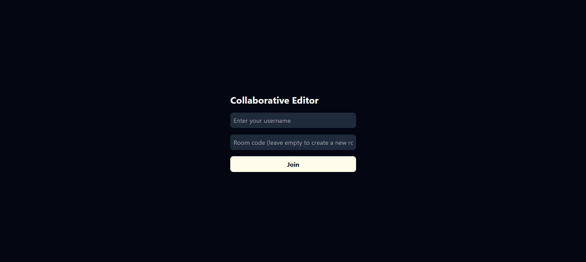

# CodeRoom

**Real-time collaborative code editor in your browser.** Create a room, share the link, and code together with live text sync, shared cursors and a live user list. No sign-up needed.

[**Live Demo**](https://coderoom-c2jd.onrender.com/) | [GitHub](https://github.com/Sonalpal/CodeRoom)




> The demo runs on a free server that sleeps when idle. The first load can take up to a minute.

---

## Features

- **Real-time sync:** edits from every user merge instantly without conflicts, powered by Yjs (a CRDT).
- **Private rooms:** each room has its own document. Create one with a random code, or join an existing one by code or invite link.
- **Invite links:** one click copies a link like `/?room=k3x9ab` to share with a teammate.
- **Live cursors and selections:** see where other people are typing.
- **Online users list:** shows who is currently in your room.
- **Unique usernames per room:** enforced on the server (case-insensitive), so two people can't join the same room under the same name, even if they click Join at the same moment.
- **Monaco editor:** the editor engine behind VS Code, with syntax highlighting and the `vs-dark` theme.

## Tech Stack

| Layer | Technology |
|---|---|
| Frontend | React 19, Vite, Tailwind CSS 4 |
| Editor | Monaco Editor, `@monaco-editor/react` |
| Real-time sync | Yjs, `y-monaco`, `y-socket.io` |
| Backend | Node.js, Express, Socket.IO |
| Deployment | Render (Docker / AWS ECS also possible) |

## How It Works

```
Browser A ──┐                          ┌── Browser B
 Monaco  ◄──┤                          ├──►  Monaco
 Yjs doc    │   Socket.IO (WebSocket)  │     Yjs doc
            └────────►  Express  ◄─────┘
                       + y-socket.io
                      (one Yjs doc per room)
```

1. Each browser holds a local Yjs document bound to the Monaco editor.
2. Changes are sent as small updates over Socket.IO to the server, which relays them to everyone in the same room.
3. Because Yjs uses a CRDT, updates can arrive in any order and every client still ends up with the same text.
4. A separate `join` event on the server reserves your username for the room. The name is released when you disconnect.

## Project Structure

```
.
├── backend/
│   ├── server.js        # Express + Socket.IO + Yjs server, username/room checks
│   ├── public/          # Built frontend (copied from frontend/dist)
│   └── package.json
└── frontend/
    ├── src/
    │   ├── main.jsx
    │   └── app/
    │       ├── App.jsx  # Join screen, rooms, editor, user list
    │       └── App.css
    ├── vite.config.js   # Includes a dev proxy for /socket.io
    └── package.json
```

## Getting Started

**Prerequisites:** Node.js 18 or newer and npm.

### 1. Clone the repo

```bash
git clone https://github.com/Sonalpal/CodeRoom.git
cd CodeRoom
```

### 2. Run in development (two terminals)

**Terminal 1: backend**
```bash
cd backend
npm install
node server.js
```

**Terminal 2: frontend**
```bash
cd frontend
npm install
npm run dev
```

Open the link Vite prints (usually `http://localhost:5173`). Socket traffic is proxied to the backend on port 3000.

### 3. Run as a single production-style app

```bash
cd frontend
npm install
npm run build

# copy the build into the backend
cp -r dist ../backend/public        # Windows PowerShell: Copy-Item -Recurse dist ..\backend\public

cd ../backend
npm start
```

Open `http://localhost:3000`.

## Try It

1. Open the app, enter a username, leave the room box empty and click **Join**.
2. Click **Copy invite link** and open it in a second tab or browser.
3. Join with a different username and start typing. Both editors stay in sync.

## Deployment

The app is deployed as a single Render Web Service. The backend serves the built frontend.

| Setting | Value |
|---|---|
| Build command | `cd frontend && npm install --include=dev && npm run build && cd ../backend && npm install && rm -rf public && cp -r ../frontend/dist public` |
| Start command | `cd backend && npm start` |
| Health check path | `/health` |

The server reads the port from the `PORT` environment variable and falls back to `3000`.

## Known Limitations

- **Rooms are stored in server memory.** Documents survive while the server is running but are lost on restart.
- **Single server instance.** Room data and the username list are not shared between multiple instances, so scaling out would need a shared layer such as Redis.
- **No passwords on rooms.** Anyone with the room code can join.
- **Usernames are not accounts.** A name is reserved only while its owner is connected.
- **Free hosting sleeps when idle**, so the first request after a pause is slow.

## Roadmap

- [ ] Save documents to a database (for example MongoDB) so rooms persist
- [ ] Language selector (JavaScript, Python, C++, and more)
- [ ] Password-protected rooms
- [ ] Per-user cursor colors with name labels
- [ ] Run code in the browser
- [ ] Scale across multiple instances with Redis

## Author

**Sonal Pal**
GitHub: [@Sonalpal](https://github.com/Sonalpal)

## License

This project is licensed under the MIT License.